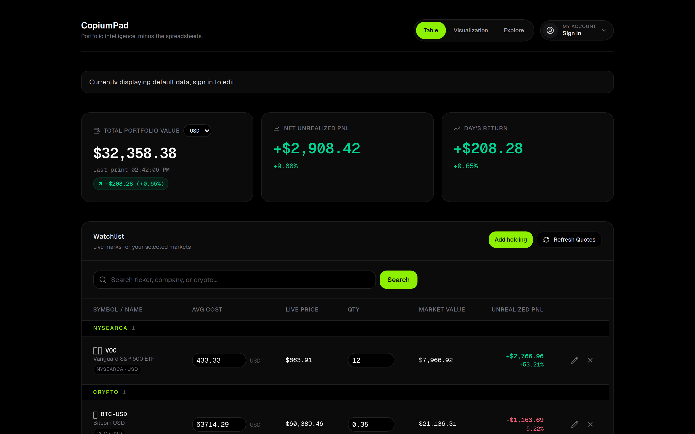
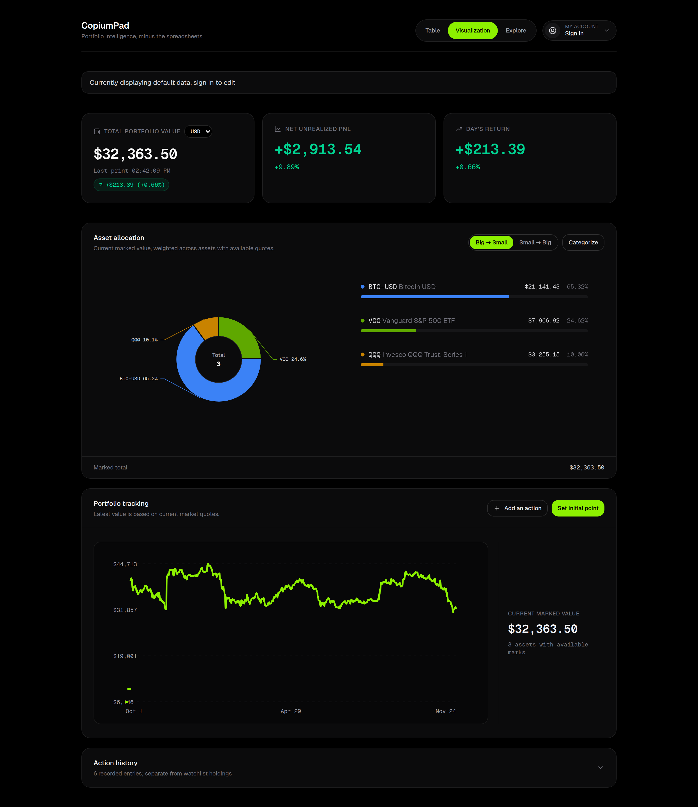
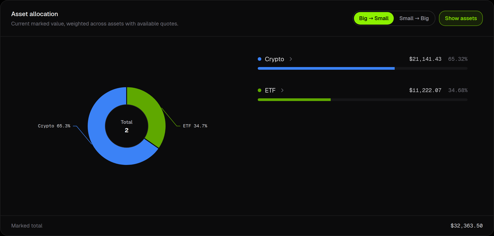
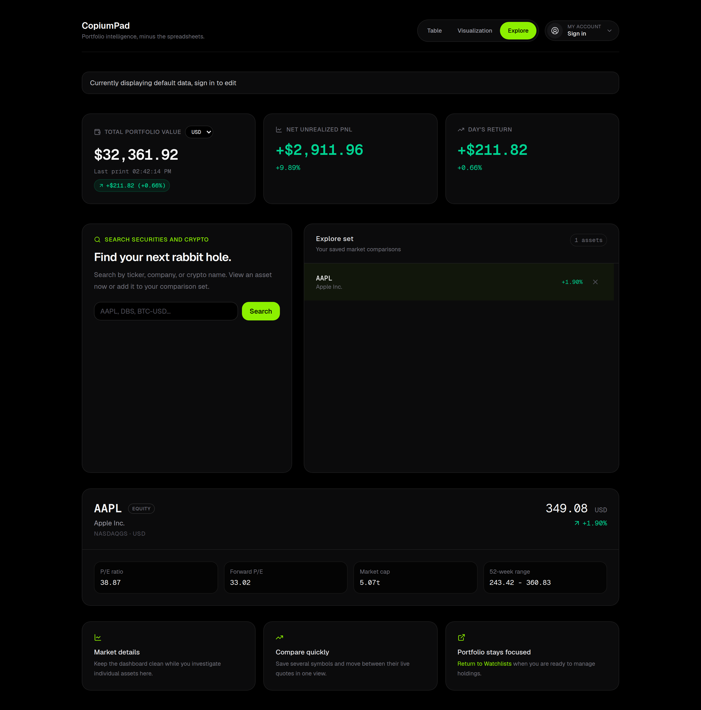
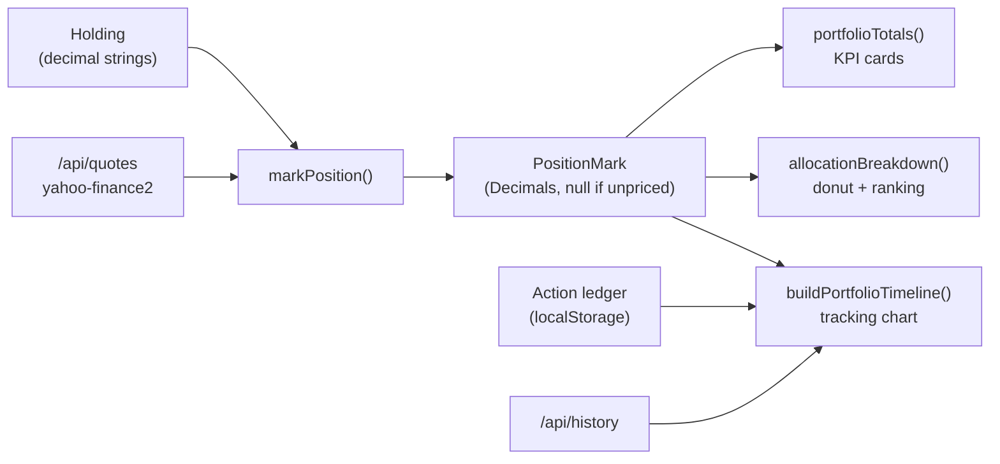

# CopiumPad 💊

> Institutional-grade copium for retail traders.
> Kill your broken Google Sheets with real-time portfolio tracking and scenario simulation.

**[Live demo → copium-pad.vercel.app](https://copium-pad.vercel.app/)** · no sign-up needed, guests see a read-only demo portfolio.




---

## Why CopiumPad?

Most retail portfolios live in a spreadsheet full of `GOOGLEFINANCE()` calls that break, can't price crypto and SGX in one sheet, and quietly round your PnL wrong. CopiumPad replaces that with:

- **Live marks** for stocks, ETFs and crypto across global exchanges, in one table.
- **Multi-currency totals.** Each asset is priced in its own currency, and the whole portfolio can be shown in USD, SGD, CNY, GBP, EUR, HKD or TWD.
- **Exact money math.** Every amount is a `decimal.js` value, so no floating-point drift.
- **Scenario tracking.** Replay a BUY/SELL ledger against daily price history to see how the portfolio *would have* moved.

---

## Features

### 1. Portfolio KPIs

Three headline cards sit above every view:

| Card | What it shows |
| --- | --- |
| **Total Portfolio Value** | Marked value of every priced holding, with a display-currency picker and a "last print" timestamp |
| **Net Unrealized PnL** | Market value minus book cost, in absolute and percentage terms |
| **Day's Return** | Session PnL based on each asset's day change |

**Powered by:** pure functions in [`src/lib/finance/`](src/lib/finance). `markPosition()` turns a holding and a quote into a `PositionMark`, and `portfolioTotals()` sums those marks in USD. FX rates come from the `/api/quotes` route (`yahoo-finance2`). Every amount is a `decimal.js` `Decimal`. The display currency is applied last, by dividing by `displayCurrencyUsdRate`.

### 2. Live watchlist table

*(See the screenshot at the top.)*

- Holdings are **grouped by exchange** (NYSEARCA, NASDAQ, SES…) or **Crypto**, each with a country flag and an `EXCHANGE · CURRENCY` badge.
- Columns: Avg Cost, Live Price, Qty, Market Value, Unrealized PnL (value and %).
- **Edit inline.** Type into Avg Cost or Qty and it autosaves after a 400 ms pause or on blur.
- **Search to add.** Search by ticker, company or crypto name and add the result as a holding. Assets you already hold are flagged.
- Add, edit or remove holdings in a dialog, and refresh quotes manually.
- Click any symbol to open it in **Explore**.

**Powered by:** **TanStack Query 5** with optimistic mutations. The cache updates first, and only the failed item rolls back. Holdings are saved with a **Supabase** `positions` upsert keyed on `(user_id, symbol)` and protected by owner-scoped RLS. Search uses `/api/search` (`yahoo-finance2` search). Quantities and costs stay decimal **strings** from input to database, so nothing gets rounded on the way.

### 3. Visualization



**Asset allocation**
- A donut chart and a ranked list, sortable **Big → Small** or **Small → Big**.
- **Categorize** groups holdings into Crypto, ETF or market regions such as US Market and SG Market. Click a group to see its holdings.

<p align="center"></p>

**Portfolio tracking**
- A timeline of portfolio value, built by replaying a **BUY/SELL action ledger** against daily closing prices.
- **Set initial point** records your current holdings as a baseline. Later actions build on it, and the chart shows a break where the baseline was set.
- A collapsible **Action history** table lists and deletes entries.

**Powered by:** `allocationBreakdown()`, `categoryForQuote()`, `sortByValue()` and `buildPortfolioTimeline()` in [`src/lib/finance/portfolio.ts`](src/lib/finance/portfolio.ts), with daily history from the `/api/history` route (`yahoo-finance2` `chart`). Both charts are **hand-rolled SVG** with no chart library. Transitions use **framer-motion** (`layoutId` pills, staggered rows).

### 4. Explore



- Look up any security or crypto pair without adding it to your portfolio.
- Keep a saved **Explore set** to switch between live quotes.
- Each quote card shows price, day change, asset type and exchange, plus **P/E, Forward P/E, Market cap and 52-week range** (crypto skips these).
- Links are shareable: `/?view=explore&symbol=AAPL`.

**Powered by:** `/api/quotes` and `/api/search`. The Explore set is saved in `localStorage` (`copiumpad_explore_symbols`). The view is part of the single-page shell, which tracks the URL with `history.pushState` and a `popstate` listener instead of full Next.js navigations.

### 5. Alerts

- **Price alerts** (symbol and target price) and **Deposit alerts** (date and time), each with a custom message.
- A recent-alerts list where you can delete alerts.

**Powered by:** a Supabase `alerts` table with owner-scoped RLS. Users can only insert and delete, so they can't mark their own alerts as triggered. Emails go out through **Resend** via `POST /api/send-alert`. That route only sends alerts a trusted process has already marked as triggered, and only to the signed-in user's own email.

### 6. Accounts & guest mode

- **Passwordless sign-in.** Email one-time links, with no passwords to leak.
- Profile editing (username and avatar, stored in a Supabase Storage `avatars` bucket).
- **Guest mode.** Signed-out visitors see a read-only demo portfolio, and any write prompts them to sign in.
- On first sign-in, any positions in legacy browser storage (`copiumpad_positions`) are imported once.

**Powered by:** `@supabase/ssr` and `@supabase/supabase-js`. A single auth store ([`src/lib/supabase/auth-store.ts`](src/lib/supabase/auth-store.ts)) reads the session locally with no network call, then re-checks it with `getUser()` in the background. `AuthQuerySync` clears cached data from other users and loads positions, profile and alerts in parallel.

---

## Tech stack

| Layer | Technology | Role in CopiumPad |
| --- | --- | --- |
| Framework | **Next.js 16** (App Router) | Single-page dashboard shell and `/api/*` route handlers |
| UI runtime | **React 19** | Suspense-driven loading, client components |
| Language | **TypeScript** (strict, no `any`) | End-to-end types from quote to chart point |
| Styling | **Tailwind CSS 4**, `tw-animate-css` | Dark-first, institutional look (Koyfin / TradingView / Raycast) |
| Components | **shadcn** (base-nova) on **`@base-ui/react`**, **lucide-react** | Accessible primitives and icons |
| Motion | **framer-motion** | View transitions, active-pill animations, list reordering |
| Server state | **TanStack Query 5** | Caching, prefetching, optimistic mutations with rollback |
| Database & auth | **Supabase** (Postgres + RLS, Auth, Storage) | Positions, profiles, alerts, avatars, email sign-in |
| Market data | **yahoo-finance2** | Quotes, FX, search, daily history |
| Precision | **decimal.js** | All money, quantity and percentage arithmetic |
| Email | **Resend** | Alert delivery |
| Testing | **Vitest** | Unit tests for finance math, query layer and auth store |
| Tooling | **pnpm**, ESLint 9 | Package management and linting |

---

## Architecture



- **Single-page shell.** [`src/app/page.tsx`](src/app/page.tsx) renders the header and `PortfolioDashboard`, which holds all three views (`table`, `visualization`, `explore`). The active view and symbol live in `?view=` and `?symbol=`.
- **Data fetched in the browser.** All Supabase reads run in the browser through TanStack Query, so the Next.js Data Cache doesn't apply. The query layer ([`src/lib/queries/`](src/lib/queries)) has no React code, so it's unit-tested in Node.
- **Two independent stores.**
  - *Positions* → the Supabase `positions` table (synced, per-user).
  - *Actions* (the BUY/SELL ledger) → `localStorage` only. They only feed the timeline chart, never the KPI cards.
- **Public market-data routes.** `quotes`, `history` and `search` wrap `yahoo-finance2` and return `{ success, data?, error? }`. Supabase access from the browser relies on RLS.

### Precision first

- Money is never computed with JavaScript's native `+ - * /`. Every amount is a `Decimal`.
- If a quote fails, that symbol comes back as `error: true, price: 0`. `markPosition()` treats it as **unpriced** and sets its values to `null`, and totals skip it rather than counting it as $0.
- Currency conversion runs in a fixed order: asset currency → USD (`usdRate`) → display currency (`displayCurrencyUsdRate`).

---

## Project structure

```text
src/
├── app/
│   ├── page.tsx                 # SPA shell: header, view state, Suspense
│   ├── explore/page.tsx         # redirects to /?view=explore
│   ├── auth/confirm/route.ts    # email OTP callback
│   └── api/
│       ├── quotes/route.ts      # live quotes + FX
│       ├── history/route.ts     # daily closes for the timeline
│       ├── search/route.ts      # ticker / company / crypto search
│       └── send-alert/route.ts  # Resend email for triggered alerts
├── components/                  # dashboard, visualization, explore, dialogs, charts
├── hooks/                       # useAuthUser, usePortfolioStorage, usePortfolioActions
└── lib/
    ├── finance/                 # pure decimal.js math (+ tests)
    ├── queries/                 # query keys, fetchers, mutation options (+ tests)
    ├── supabase/                # browser/server clients, auth store (+ tests)
    └── constants/defaultData.ts # guest-mode demo portfolio
supabase/
├── schema.sql                   # profiles, positions, RLS, avatars bucket
└── alerts.sql                   # alerts table + RLS
```

---

## Getting started

### Prerequisites
- Node.js 20+
- pnpm
- A Supabase project (optional: without it the app runs in guest mode with demo data)

### Install & run

```bash
pnpm install
pnpm dev        # http://localhost:3000
```

### Supabase setup

1. Create a Supabase project and copy `.env.example` to `.env.local`. Fill in:
   - `NEXT_PUBLIC_SUPABASE_URL`
   - `NEXT_PUBLIC_SUPABASE_ANON_KEY`
2. Run [`supabase/schema.sql`](supabase/schema.sql) in the Supabase SQL Editor. It creates the profile and position tables, their RLS policies and the public `avatars` bucket.
3. In **Authentication**, enable email OTP / magic links and add these redirect URLs: `http://localhost:3000/auth/confirm`, `http://localhost:3001/auth/confirm`, and your deployed `/auth/confirm` URL.
4. Run [`supabase/alerts.sql`](supabase/alerts.sql) to create the owner-scoped `alerts` table.
5. For alert emails, set `RESEND_EMAIL_API_KEY` and `RESEND_FROM_EMAIL` in `.env.local`. The sender domain must be verified in Resend.

> Alerts are created as **pending**. `/api/send-alert` only emails an alert after a trusted trigger process (not included in this repo) marks it triggered. The email goes to the signed-in account's address, with the custom message as the body.

---

## Scripts

| Command | Description |
| --- | --- |
| `pnpm dev` | Start the dev server |
| `pnpm build` / `pnpm start` | Production build / serve |
| `pnpm lint` | ESLint |
| `pnpm test` | Run all Vitest tests once |
| `pnpm vitest run src/lib/finance/money.test.ts` | Run a single test file |
| `pnpm vitest run -t "markPosition"` | Run tests matching a name |
| `pnpm tsc --noEmit` | Type-check |

## Testing

Tests run in Vitest's `node` environment and cover `src/lib`:
- **Finance math**: market value, PnL, day PnL, allocation, timeline replay, including unpriced and edge cases.
- **Query layer**: position and alert fetchers and optimistic update/rollback helpers, run against a fake Supabase client.
- **Auth store**: session hydration and background validation.

---

## Known limitations

- The BUY/SELL action ledger lives in browser `localStorage`, so it isn't synced across devices or tied to an account yet.
- Alert triggering needs an external trusted process (not included in this repo).
- Market data comes from Yahoo Finance through unofficial endpoints, so quotes may be delayed or rate-limited.
